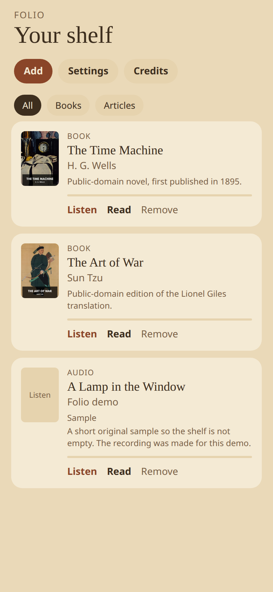
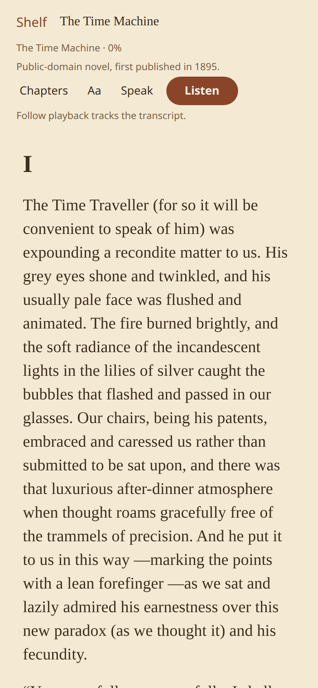
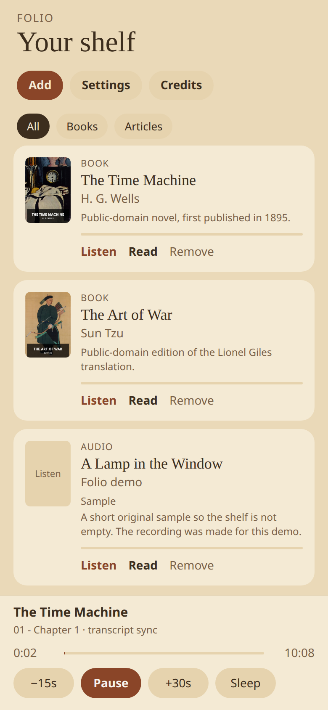

# Folio

A reader for books, audiobooks, saved articles, and short audio. Mostly AI-generated with Cursor.

One library on the device, no account. Text and audio can be read and listened to, including together. The first launch opens a small demo shelf: two public-domain books (an EPUB plus the opening LibriVox chapter) and one short original sample with a recording made for this demo.

## Why I made this

I wanted a Kindle-like interface to read and listen to long X posts, articles, long AI chat responses, and books, using the top free AI voice models.

<p>
  
  
  
</p>

Opening the shelf, reading a chapter, and starting playback:

<p>
  <a href="docs/screenshots/shelf-to-reader.mp4">
    
  </a>
</p>

The clip is a Playwright pass of the web build at 390×844 with touch. [MP4](docs/screenshots/shelf-to-reader.mp4).

## Features

- Shelf with filters: All, Books, Articles
- Reader with light, sepia, and dark themes, serif or sans, type size, line spacing, and margins
- Follow playback from a WebVTT transcript, and an estimate when a recording has no transcript
- Now-playing bar with play, skip, and a sleep timer. Tapping the title opens that item
- Import a DRM-free EPUB (file or URL), an article URL, an X post through a public mirror, or MP3 / M4A / M4B. A `.vtt` or `.txt` picked with the audio becomes a read-along item
- Audio bundles: a zip, or `folio.json` plus the files it names
- Pair an audio item with a book. That turns on approximate sync
- A scripted audio item can play the bundled recording or the voice chosen in Settings
- Three narration engines. Gemini falls through to Kokoro, then the system voice. Kokoro falls through to the system voice
- Later LibriVox chapters download once into the item’s folder and then play offline
- Credits lists the sources for items on the shelf

Kindle and Audible DRM are out of scope.

## Stack

| Part | Tech |
| --- | --- |
| App | Expo SDK 58, expo-router, React Native, TypeScript |
| Audio | expo-audio (background playback), expo-speech |
| On-device voice | Kokoro 82M (`q8`) in a hidden WebView, via kokoro-js and ONNX Runtime WASM |
| Cloud voice | Gemini TTS. The key is pasted in Settings and stored with expo-secure-store |
| Web preview | The same app, with IndexedDB instead of the phone document directory |
| Checks | `node:test` via `tsx`, Playwright |

There is no account and no Supabase. With nothing configured, the shelf stays on the device.

## Setup

Use Node.js 22. On iPhone, open the project in **Expo Go for SDK 58**. The runtime version follows the SDK (`exposdk:58.0.0`).

```bash
npm install
cp .env.example .env   # names only; the reader runs with the values empty
npm start
```

A dev build, if you want one:

```bash
npx expo run:ios
```

Kokoro runs in a WebView, so it does not need that dev build. Background playback and the lock screen are declared through the `expo-audio` config plugin. Expo Go already plays audio in the background for this SDK.

Web preview, on the same port the UI checks use:

```bash
npx expo start --web --port 43921
```

## Environment

`.env` is gitignored. `.env.example` is the committed file, and it has empty placeholders.

| Name | What it's for |
| --- | --- |
| `FOLIO_LIVE_ARCHIVE` | Set to `1` on the command line to let the Playwright suite download one real LibriVox chapter. Playwright does not load `.env` by itself: `FOLIO_LIVE_ARCHIVE=1 npm run test:ui` |
| `EXPO_TOKEN` | Expo / EAS CLI only, when you publish an update. The app does not read it and does not bundle it |
| `GEMINI_API_KEY`, `GOOGLE_API_KEY` | Listed in `.env.example` so a real key is not pasted into a committed file. The app does not read them |

A Gemini key is pasted in Settings. On a phone it stays in secure storage. On the web preview it stays in that browser’s local storage.

`app.json` keeps the existing Expo owner, EAS project id, and `expo-updates` URL. Those are the client identifiers the update client uses. They are not API keys.

## Checks

```bash
npx tsc --noEmit
npm test
npm run test:ui
```

`npx tsc --noEmit` is the check that passes with the committed dependencies. `npm test` is the unit suite. `test:ui` opens the web app and checks controls on screen. Chapter audio in that suite comes from `e2e/fixtures/librivox-chapter.mp3`.

`npm run lint` runs `expo lint`. This repo does not commit an ESLint config, so that command offers to install `eslint` and `eslint-config-expo` on first use. Those packages are not part of the lockfile.

## On the shelf

| Title | Text | Audio on device | Rest of the audiobook |
| --- | --- | --- | --- |
| The Time Machine, H. G. Wells | Standard Ebooks | LibriVox chapter 1 | Archive.org, on play |
| The Art of War, Sun Tzu (Lionel Giles) | Standard Ebooks | Laying Plans | Archive.org, on play |
| A Lamp in the Window | Original demo text | Short synthetic reading, with WebVTT | None |

## Voices

Settings offers three.

1. **System**, `expo-speech`. Default, offline. On iOS, Enhanced or Premium voices downloaded in Settings → Accessibility → Spoken Content → Voices show up in the list. The web preview uses the browser voice.
2. **Kokoro**, [Kokoro 82M](https://huggingface.co/onnx-community/Kokoro-82M-v1.0-ONNX) at `q8`, inside a hidden WebView. The model downloads on first use and stays cached. Clips are cached per item as 16-bit WAV. Native `sherpa-onnx` does not load in Expo Go, so Folio does not use it.
3. **Gemini**, a key you paste from [Google AI Studio](https://aistudio.google.com/apikey). The read-aloud default model is `gemini-3.8-flash-lite-tts`. A free-tier 429 backs off and retries, then Folio falls through to Kokoro and the system voice. Finished sentences are cached on the device.

## Audio bundle format

A bundle is a zip, a folder, or a URL to a zip. The manifest is `folio.json`:

```json
{
  "folio": 1,
  "kind": "audio",
  "title": "A Lamp in the Window",
  "author": "Folio demo",
  "description": "A short original sample so the shelf is not empty.",
  "publishedAt": "2026-01-15T15:00:00Z",
  "audio": "audio.mp3",
  "captions": "captions.vtt",
  "script": "script.txt"
}
```

`folio` must be `1`. `kind` is `audio`, `audiobook`, or `book`. `audio`, `captions`, and `script` are file names next to the manifest. Captions are WebVTT. The script is the text the reader shows. `assets/seed/demo/lamp` is the bundled example.

## Layout

```
src/app/         Expo Router screens: shelf, import, reader, settings, credits
src/components/  Shelf cards, reader, now-playing bar
src/state/       Library, player, settings
src/lib/         EPUB, articles, cues, Gemini, library storage
src/tts/         Kokoro WebView
src/seed/        First-launch library
src/storage/     Device files, and IndexedDB on web
assets/seed/     Bundled EPUBs, LibriVox openings, and the demo sample
assets/images/   Icon, splash, and template images
docs/screenshots Shelf, reader, and now-playing shots of this build
e2e/             Playwright checks
tests/           Unit tests
scripts/         Book-audio alignment helper
```

## Privacy

The library stays on the device. Do not commit `.env`, API keys, or tokens. `LICENSE` is the MIT notice that came with the Expo template.
